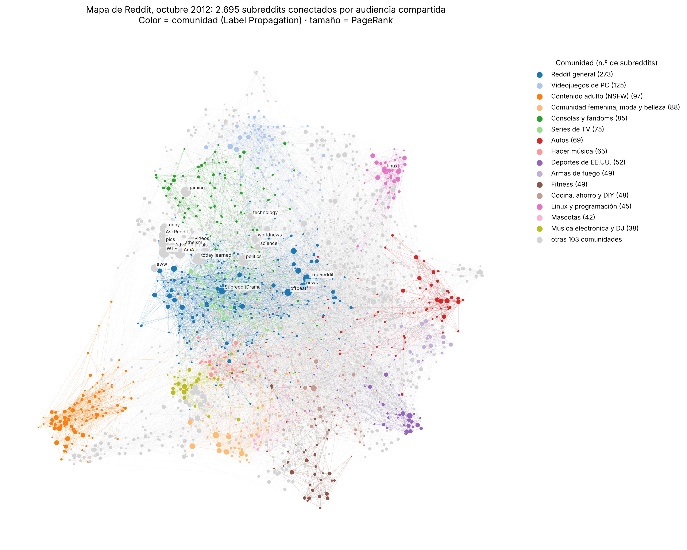
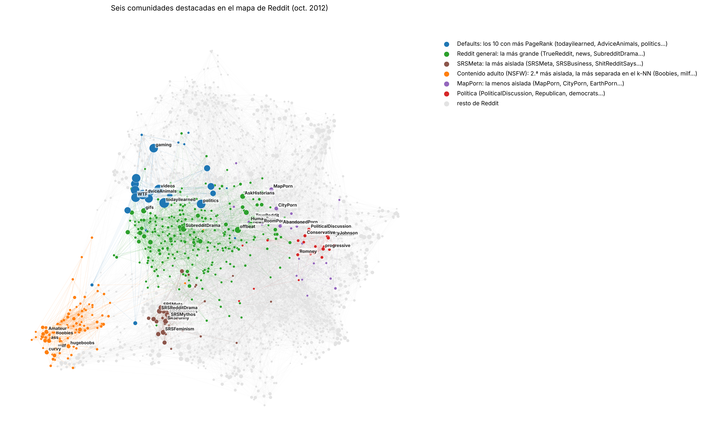
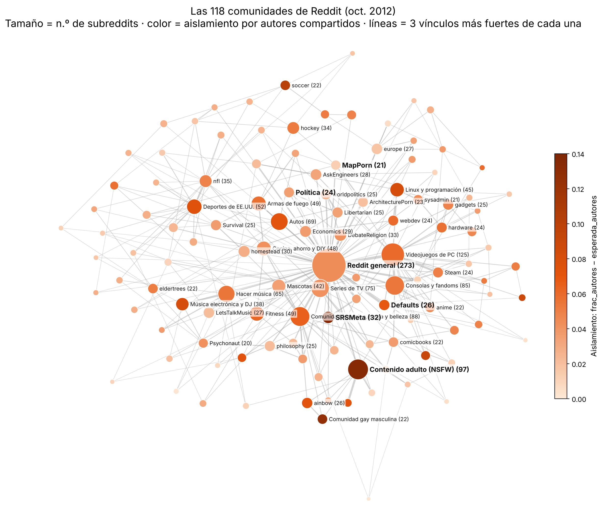

# proyectoCC5212 - Mapa de Reddit: comunidades de subreddits por audiencia compartida

Construimos un grafo de subreddits conectados por audiencia compartida, a partir de un mes de comentarios de Reddit. Sobre ese grafo, Apache Giraph detecta comunidades (Label Propagation) e identifica los subreddits más centrales (PageRank). Con Spark se calcula además qué tan aislada está cada comunidad del resto.

> **Estado (20/11/2026):** pipeline completo ejecutado sobre el mes completo: preprocesamiento, grafo, Giraph (PageRank y Label Propagation), métricas de aislamiento (`metrics.py`) y mapas (`mapas.py`).


## Estructura del repositorio

```
.
├── README.md
├── spark/
│   ├── prep.py     # Paso 1: pares (autor, subreddit) distintos y filtrados
│   ├── edges.py    # Paso 2: self-join, Jaccard y grafo k-NN para Giraph
│   └── metrics.py  # Paso 4: aislamiento de comunidades y exportación a CSV
├── giraph/         # Paso 3: PageRank y Label Propagation (proyecto mdp-giraph del Lab 8)
│   ├── build.xml           # compila y arma dist/mdp-giraph.jar con ant
│   ├── correr_giraph.sh    # comandos del clúster en orden
│   ├── datos/juguete.tsv   # grafo de prueba
│   └── src/org/mdp/hadoop/
│       ├── cli/            # PageRank, LabelPropagation, sus runners y SortByRank
│       ├── io/             # formato de entrada (TSV origen\tdestino) y de salida
│       └── pr/             # masters con los agregadores de PageRank y LPA
├── viz/
│   └── mapas.py    # Paso 5: mapas a partir de los CSV de metrics.py
└── resultados/     # salidas de los pasos 4 y 5
    ├── nodes.csv
    ├── edges.csv
    ├── comunidades.csv
    ├── enlaces_comunidades.csv
    ├── metrics.log
    ├── mapa_subreddits.png
    ├── mapa_destacado.png
    └── mapa_comunidades.png
```

## Requisitos

- Hadoop HDFS
- Apache Spark con PySpark (`spark-submit`)
- Apache Giraph 1.3 y Apache Ant (Java 8) para compilar `giraph/`; los 4 JAR de `giraph/lib/` se copian desde el Laboratorio 8 (no se suben al repo por tamaño)
- Para los mapas: Python 3 con `networkx`, `matplotlib`, `scipy` y `pandas`

## Datos

- **Fuente:** [fddemarco/pushshift-reddit-comments](https://huggingface.co/datasets/fddemarco/pushshift-reddit-comments) (Hugging Face)
- **Archivo usado:** `RC_2012-10.parquet` (comentarios de octubre de 2012)
- **Filas:** 22.855.205 comentarios
- **Columnas usadas:** `author`, `subreddit` (y `created_utc` solo para crear la muestra)

### Descarga y carga en HDFS

En el servidor, dentro de un `screen`:

```bash
wget -c "https://huggingface.co/datasets/fddemarco/pushshift-reddit-comments/resolve/main/<ruta>/RC_2012-10.parquet"
hdfs dfs -mkdir -p /uhadoop2026/projects/grupo11/raw
hdfs dfs -D dfs.replication=1 -put RC_2012-10.parquet /uhadoop2026/projects/grupo11/raw/
rm RC_2012-10.parquet
```


## Ejecución

Los scripts se copian al servidor con `scp -P 220` y se ejecutan con `spark-submit`. Para abreviar:

```bash
B=hdfs://cm:9000/uhadoop2026/projects/grupo11
```

Comandos usados para el mes completo:

```bash
spark-submit --master spark://cluster-01:7077 --total-executor-cores 4 --executor-memory 2g \
  prep.py $B/raw/ $B/autor_sub/

spark-submit --master spark://cluster-01:7077 --total-executor-cores 4 --executor-memory 2g \
  edges.py $B/autor_sub/ $B/grafo 100 50 10
```

Si los workers del clúster no entregan recursos, se puede reemplazar `--master spark://cluster-01:7077 --total-executor-cores 4 --executor-memory 2g` por `--master local[4] --driver-memory 4g`. Los resultados son los mismos.

### Paso 1: `prep.py`, pares autor–subreddit

```bash
spark-submit --master spark://cluster-01:7077 --total-executor-cores 4 --executor-memory 2g \
  prep.py <entrada> <salida>
```

- Quita filas con autor o subreddit nulo.
- Elimina `[deleted]`, `AutoModerator` y cuentas cuyo nombre termina en "bot" (heurística).
- Deja los pares (autor, subreddit) **distintos**.
- Imprime estadísticas de entrada y salida.

### Paso 2: `edges.py`, construcción del grafo

```bash
spark-submit --master spark://cluster-01:7077 --total-executor-cores 4 --executor-memory 2g \
  edges.py <entrada_autor_sub> <carpeta_salida> [MIN_AUT] [MAX_SUBS] [K]
```

1. Descarta a los autores presentes en más de `MAX_SUBS` subreddits.
2. Calcula el número de autores de cada subreddit y descarta los que tienen menos de `MIN_AUT`.
3. **Self-join por autor**: cuenta cuántos autores comparte cada par de subreddits (intersección).
4. Calcula la **similitud de Jaccard**: `inter / (n1 + n2 − inter)`.
5. Para cada subreddit conserva sus `K` vecinos con mayor Jaccard (**grafo k-NN**).
6. Escribe los TSV para Giraph.

### Parámetros

| Parámetro | Por defecto | Qué controla |
|---|---|---|
| `MIN_AUT` | 100 | Mínimo de autores para incluir un subreddit |
| `MAX_SUBS` | 50 | Máximo de subreddits por autor para entrar al self-join |
| `K` | 10 | Vecinos por subreddit en el grafo k-NN |

### Salidas de `edges.py`

| Carpeta | Formato | Contenido |
|---|---|---|
| `aristas/` | Parquet | `s1, s2, inter, n1, n2, jaccard` (cada par una vez, `s1 < s2`) |
| `giraph-knn/` | TSV `origen\tdestino` | Grafo dirigido: cada subreddit apunta a sus `K` más similares. Entrada de PageRank. |
| `giraph-und/` | TSV `origen\tdestino` | Mismo grafo con cada arista en ambos sentidos. Entrada de Label Propagation. |


### Paso 3: Giraph, PageRank y Label Propagation

El proyecto Java está en `giraph/` y parte del proyecto `mdp-giraph` del Laboratorio 8 (mismas clases de entrada y salida, mismo `build.xml`). Las clases nuevas son:

| Clase | Qué hace |
|---|---|
| `cli/LabelPropagation` | LPA sincrónico con ids `Text`. Superstep 0: cada subreddit toma su nombre como etiqueta. Luego adopta la etiqueta más frecuente entre la suya y las de sus vecinos; en empate gana la menor. |
| `pr/LabelPropagationMaster` | Cuenta cuántos vértices cambian en cada superstep y detiene el cómputo cuando ya nadie cambia. Tope de 20 supersteps por si el LPA oscila. |
| `cli/LPARunner` | Igual que `PageRankRunner`, pero lanza `LabelPropagation`. |

`PageRank`, `PageRankAgg`, `PageRankRunner` y `SortByRank` son los del laboratorio, sin cambios (10 iteraciones, factor de amortiguación 0,85).

**Compilar:** copiar en `giraph/lib/` los 4 JAR de `lib/` del Laboratorio 8 y correr `ant` en `giraph/`. Queda `giraph/dist/mdp-giraph.jar`, que se copia al servidor con `scp -P 220` a `/data/2026/uhadoop/projects/grupo11/`.

**Ejecutar** (`giraph/correr_giraph.sh` tiene todo en orden, partiendo por el grafo de juguete):

```bash
B=/uhadoop2026/projects/grupo11
# PageRank sobre el k-NN dirigido
hadoop jar mdp-giraph.jar PageRankRunner $B/grafo/giraph-knn $B/pagerank 4
hadoop jar mdp-giraph.jar SortByRank -D mapreduce.job.reduces=1 $B/pagerank $B/pagerank-s
# Label Propagation sobre el grafo no dirigido
hadoop jar mdp-giraph.jar LPARunner $B/grafo/giraph-und $B/lpa 4
```

Entrada: los TSV `origen\tdestino` de `edges.py`, leídos con `TextNullTextEdgeInputFormat`. Salidas en HDFS:

| Carpeta | Formato | Contenido |
|---|---|---|
| `pagerank/` | TSV `subreddit\trank` | PageRank de cada subreddit |
| `pagerank-s/` | TSV `subreddit\trank` | Lo mismo, ordenado de mayor a menor |
| `lpa/` | TSV `subreddit\tetiqueta` | Comunidad de cada subreddit (la etiqueta es el nombre de uno de sus miembros) |

**Prueba con grafo de juguete** (`giraph/datos/juguete.tsv`, dos triángulos unidos por `c–d`): resultado `a, b, c → a` y `d, e, f → d`, igual al esperado.

### Paso 4: `metrics.py`, aislamiento de comunidades y exportación

```bash
spark-submit --master spark://cluster-01:7077 --total-executor-cores 4 --executor-memory 2g \
  metrics.py $B
```

Lee `grafo/aristas/`, `grafo/giraph-und/`, `pagerank/` y `lpa/` desde `$B`, los une por nombre de subreddit, y escribe en `$B/resultados/` cuatro carpetas, cada una con un solo CSV con encabezado. Solo lee esas carpetas y crea `resultados/`; no modifica nada más. Al final imprime comprobaciones (nodos, aristas y comunidades que deben calzar con los pasos anteriores) y la tabla de comunidades ordenada por `frac_knn`.

| Carpeta | Columnas | Contenido |
|---|---|---|
| `nodes/` | `Id, Label, comunidad, pagerank, n_autores` | Un subreddit por fila |
| `edges/` | `Source, Target, Weight, Type` | Conexiones del grafo k-NN, cada una una sola vez. `Weight` es el Jaccard. |
| `comunidades/` | `Id, Label, n_subreddits, frac_knn, esperada_knn, frac_autores, esperada_autores, top_subreddits` | Una comunidad por fila. `Id` es la etiqueta de LPA, `Label` su miembro con mayor PageRank y `top_subreddits` sus 5 miembros con mayor PageRank. |
| `enlaces_comunidades/` | `Source, Target, Weight, autores_compartidos, Type` | Conexiones entre comunidades. `Weight` es el número de aristas k-NN que las unen. |

**Criterio de aislamiento.** Para cada comunidad se mide qué fracción de su volumen de conexiones queda dentro de ella, `2·I / (2·I + E)` (`I`: conexiones internas, `E`: las que salen; equivale a 1 − conductancia), de dos formas:

- `frac_knn`: sobre el grafo k-NN, cada arista vale 1.
- `frac_autores`: sobre los 1,4 millones de pares de `aristas/`, cada par pesado por sus autores compartidos.

`esperada_*` es la fracción del volumen total del grafo que tiene la comunidad, es decir, su fracción interna si las conexiones se repartieran al azar.

**Medida para el aislamiento** Se usa el exceso por autores: `frac_autores − esperada_autores`, debido a que:

- **`frac_knn` no sirve para medir aislamiento** Label Propagation armó las comunidades sobre el grafo k-NN agrupando subreddits que están muy conectados entre sí. Si después medimos en ese mismo grafo cuántas conexiones quedan dentro de cada comunidad, el resultado va a salir alto casi siempre, porque el algoritmo las formó justamente así. Por eso `frac_knn` la usamos solo para comprobar que LPA encontró comunidades bien definidas.
- **`frac_autores` sí sirve**, porque se calcula sobre el otro grafo, el de todos los pares de subreddits que comparten autores (1,4 millones), y no solo los 10 vecinos que usó LPA. Así medimos el aislamiento con información que el algoritmo no vio.
- **Hay que restarle lo esperado**, porque una comunidad grande tiene muchas conexiones internas solo por ser grande. Por ejemplo, en los *defaults* el 48 % de las conexiones queda adentro, pero por su tamaño ya se esperaba un 41 %. Lo que de verdad indica aislamiento es la diferencia entre ambos valores.
- **Restamos en vez de dividir** porque la división da números enormes en comunidades chicas, que tienen un valor esperado casi cero (una de 14 subreddits llega a 61 veces lo esperado). La resta tampoco es perfecta, porque favorece un poco a las comunidades grandes. Por eso los rankings solo comparan comunidades de **20 o más subreddits**, y en las tablas mostramos también `frac_autores` y `esperada_autores` por separado.

El exceso se calcula restando dos columnas de `comunidades.csv`.

Los CSV se bajan del clúster con:

```bash
H=/uhadoop2026/projects/grupo11/resultados
for t in nodes edges comunidades enlaces_comunidades; do hdfs dfs -getmerge $H/$t $t.csv; done
```

y quedan en `resultados/` de este repositorio, junto con `metrics.log` (la salida del script).

### Paso 5: `mapas.py`, visualización

En un PC, desde la raíz del repositorio:

```bash
pip install networkx matplotlib scipy pandas
python viz/mapas.py resultados/
```

Lee los CSV del paso 4 y genera tres imágenes en `resultados/` (tarda unos 3–4 minutos, casi todo en calcular las posiciones):

| Imagen | Qué muestra |
|---|---|
| `mapa_subreddits.png` | Los 2.695 subreddits. Color = comunidad (las 15 más grandes, con los temas de la tabla de Label Propagation), tamaño = PageRank |
| `mapa_destacado.png` | Las mismas posiciones, con seis comunidades destacadas y el resto en gris |
| `mapa_comunidades.png` | Una burbuja por comunidad. Tamaño = n.º de subreddits, color = exceso por autores (`frac_autores − esperada_autores`), líneas = los 3 vínculos más fuertes de cada comunidad |

Las posiciones se calculan con ForceAtlas2 (`networkx`) **sin pesos**: el Jaccard es muy chico (0,01–0,3) y, con pesos, la atracción casi no actúa y las comunidades no se separan. La disposición puede salir rotada o reflejada si se vuelve a generar; solo las distancias entre grupos tienen significado.

Comunidades destacadas en `mapa_destacado.png` (diccionario `DESTACADAS` de `mapas.py`):

| Comunidad | Criterio |
|---|---|
| *Defaults* | Contiene a los 10 subreddits con más PageRank |
| Reddit general | La más grande (273 subreddits) |
| SRSMeta | La más aislada (mayor exceso por autores) |
| Contenido adulto (NSFW) | Segunda por exceso, casi empatada con SRSMeta, y la más separada en el k-NN |
| MapPorn | La menos aislada (menor exceso y menor `frac_knn` entre las de 20 o más subreddits) |
| Política | La comunidad comentada en la sección de Label Propagation |


## Resultados con el mes completo (octubre de 2012)

### `prep.py`

| Métrica | Valor |
|---|---|
| Comentarios (filas de entrada) | 22.855.205 |
| Pares autor–subreddit distintos | 4.918.269 |
| Autores distintos | 1.130.728 |
| Subreddits distintos | 20.831 |

En promedio, cada autor comentó en unos 4,3 subreddits distintos durante el mes.

### `edges.py` (`MIN_AUT=100`, `MAX_SUBS=50`, `K=10`)

| Métrica | Valor |
|---|---|
| Subreddits (nodos) | 2.695 |
| Pares de subreddits con autores en común | 1.414.749 |
| Aristas k-NN dirigidas | 26.950 |
| Líneas en el grafo no dirigido | 38.758 (19.379 conexiones distintas) |
| Pares k-NN recíprocos | 7.571 |


### PageRank en Giraph (`giraph-knn`)

| Métrica | Valor |
|---|---|
| Vértices / aristas | 2.695 / 26.950 |
| Workers | 4 |
| Supersteps | 13 (10 iteraciones + activar, contar y cerrar) |
| Mensajes enviados | 296.450 |
| Tiempo de cómputo en Giraph | 13,3 s (50 s el job completo) |
| `SortByRank` | 36 s |

Subreddits más centrales (si el rank fuera parejo, cada uno tendría 1/2.695 ≈ 0,00037):

| # | Subreddit | PageRank |
|---|---|---|
| 1 | todayilearned | 0,00850 |
| 2 | AdviceAnimals | 0,00795 |
| 3 | videos | 0,00755 |
| 4 | WTF | 0,00697 |
| 5 | politics | 0,00676 |
| 6 | gaming | 0,00657 |
| 7 | pics | 0,00655 |
| 8 | funny | 0,00636 |
| 9 | IAmA | 0,00600 |
| 10 | AskReddit | 0,00550 |

Los más centrales son los subreddits *default* de 2012: comparten audiencia con casi todos, así que muchos los tienen entre sus 10 más parecidos.

### Label Propagation en Giraph (`giraph-und`)

| Métrica | Valor |
|---|---|
| Vértices / aristas | 2.695 / 38.758 |
| Workers | 4 |
| Supersteps | 21 (llegó al tope de 20) |
| Mensajes enviados | 775.160 |
| Tiempo de cómputo en Giraph | 15,2 s (45 s el job completo) |
| Comunidades | 118 |
| Comunidad más grande | 273 subreddits (10 % del grafo) |
| Subreddits inestables al terminar | 8 de 2.695 (0,3 %) |

Como el LPA sincrónico puede oscilar, se midió con la salida cuántos subreddits cambiarían en un superstep más: solo 8 de frontera (sociology, askphilosophy, linguistics, Archaeology, MapPorn, polandball, rockhounds y CallOfDuty).

Comunidades más grandes. El tema se asignó a mano a partir de sus 5 miembros con mayor PageRank:

| # | Subreddits | Tema | Miembros con más PageRank |
|---|---|---|---|
| 1 | 273 | Reddit general | TrueReddit, news, offbeat, SubredditDrama, gifs |
| 2 | 125 | Videojuegos de PC | Games, truegaming, GameDeals, gamernews, Minecraft |
| 3 | 97 | Contenido adulto (NSFW) | Boobies, milf, Amateur, curvy, ass |
| 4 | 88 | Comunidad femenina, moda y belleza | TwoXChromosomes, AskWomen, TrollXChromosomes, MakeupAddiction, femalefashionadvice |
| 5 | 85 | Consolas y fandoms | pokemon, TheLastAirbender, PS3, xbox360, zelda |
| 6 | 75 | Series de TV | community, television, PandR, thewalkingdead, arresteddevelopment |
| 7 | 69 | Autos | Autos, Justrolledintotheshop, carporn, cars, forza |
| 8 | 65 | Hacer música | WeAreTheMusicMakers, audioengineering, Guitar, Bass, musictheory |
| 9 | 52 | Deportes de EE.UU. | baseball, OaklandAthletics, motorcitykitties, sports, Braves |
| 10 | 49 | Fitness | xxfitness, Fitness, weightroom, swoleacceptance, fitnesscirclejerk |
| 11 | 49 | Armas de fuego | Firearms, guns, CCW, GunPorn, ar15 |
| 12 | 48 | Cocina, ahorro y DIY | Frugal, DIY, Cooking, food, BuyItForLife |
| 13 | 45 | Linux y programación | linux, linuxquestions, linux4noobs, programming, linux_gaming |
| 14 | 42 | Mascotas | Pets, dogpictures, cats, dogs, lookatmydog |
| 15 | 38 | Música electrónica y DJ | edmproduction, DJs, electrohouse, electronicmusic, Beatmatch |

**Política.** `politics`, `worldnews` y `atheism` quedan en una comunidad de 26 subreddits junto a `AdviceAnimals` (el núcleo de los *defaults*). Los subreddits de política de nicho forman otra comunidad aparte, de 24, que mezcla todos los lados: `Republican`, `Conservative`, `conservatives`, `prolife` y `Romney` junto a `democrats`, `Liberal`, `progressive`, `obama`, `GreenParty` y `GaryJohnson`, además de `PoliticalDiscussion`, `NeutralPolitics`, `moderatepolitics` y otros. `Libertarian` cae con `Anarchism` y `Christianity` con el bloque de debate religioso (`AdviceAtheists`).

### Aislamiento de comunidades (`metrics.py`)

Comprobaciones del log: 2.695 subreddits, 19.379 aristas k-NN y 118 comunidades, iguales a los pasos anteriores, sin valores faltantes. Hay 2.293 pares de comunidades conectados entre sí.

Las 5 comunidades más aisladas y las 5 menos aisladas según el exceso por autores, entre las 44 con 20 o más subreddits (tabla completa en `resultados/comunidades.csv`):

| | Comunidad | Subreddits | Exceso | `frac_autores` | Esperada | `frac_knn` |
|---|---|---|---|---|---|---|
| 1 | SRSMeta | 32 | 0,136 | 0,140 | 0,004 | 0,671 |
| 2 | Contenido adulto (NSFW) | 97 | 0,136 | 0,147 | 0,012 | 0,819 |
| 3 | Comunidad gay masculina | 22 | 0,127 | 0,130 | 0,003 | 0,747 |
| 4 | soccer | 22 | 0,101 | 0,105 | 0,004 | 0,780 |
| 5 | Linux y programación | 45 | 0,082 | 0,088 | 0,007 | 0,659 |
| … | | | | | | |
| 40 | philosophy | 25 | 0,022 | 0,028 | 0,006 | 0,374 |
| 41 | LetsTalkMusic | 27 | 0,021 | 0,025 | 0,004 | 0,423 |
| 42 | ArchitecturePorn | 23 | 0,020 | 0,022 | 0,002 | 0,467 |
| 43 | europe | 27 | 0,018 | 0,020 | 0,002 | 0,372 |
| 44 | MapPorn | 21 | 0,012 | 0,017 | 0,005 | 0,317 |

- **Validación:** en el k-NN, entre el 30 % y el 82 % de las conexiones de cada comunidad quedan dentro de ella, así que las comunidades de LPA están bien definidas.
- **Aislamiento:** por autores compartidos es bajo (exceso entre 0,012 y 0,136). Las comunidades tienen identidad propia, pero su audiencia también circula por el resto de Reddit; los *defaults* concentran el 41 % del volumen de autores compartidos.
- **Las más aisladas son nichos** de un tema o afición específica; **las menos aisladas** reúnen temas transversales. La comunidad de política queda en el puesto 34 de 44 (exceso 0,036).

### Mapas (`mapas.py`)








---

## Limitaciones

- Comentar en dos subreddits no implica pertenecer a ambos.
- La detección de bots es una heurística simple (nombre terminado en "bot").
- Los autores en más de 50 subreddits se descartan antes de calcular tanto la intersección como el tamaño de cada subreddit, así que el Jaccard se calcula solo sobre autores presentes en 50 subreddits o menos.
- LPA no es determinista entre implementaciones y, en su versión sincrónica, puede oscilar: 8 subreddits no se estabilizaron al llegar al tope de 20 supersteps.
- Las etiquetas de LPA son nombres de miembros, no temas; el tema de cada comunidad se asignó a mano.
- Compartir audiencia no indica cómo interactúan los usuarios: no distingue acuerdo de conflicto entre subreddits.
- Algunos subreddits chicos quedan en comunidades sin relación temática por pocas conexiones (por ejemplo, ciudades como `Lubbock` o `Pensacola`).
- `frac_knn` se mide sobre el mismo grafo con el que Label Propagation formó las comunidades, así que es alta por construcción; por eso el aislamiento se mide con `frac_autores`, sobre un grafo que LPA no usó.
- El exceso por autores no es del todo independiente del tamaño de la comunidad (favorece algo a las grandes, y la razón, a las chicas); por eso los rankings se limitan a comunidades de 20 o más subreddits.

## Pendiente

- [x] `prep.py` y `edges.py` sobre el mes completo (`MIN_AUT=100`)
- [x] PageRank en Giraph sobre `giraph-knn`
- [x] Label Propagation en Giraph sobre `giraph-und`
- [x] Métricas de comunidades (tamaño y aislamiento) con `metrics.py`
- [x] Exportación de `nodes.csv` y `edges.csv` y mapas con `mapas.py`
- [ ] Opcional: repetir con septiembre y noviembre de 2012 y comparar el bloque político alrededor de la elección